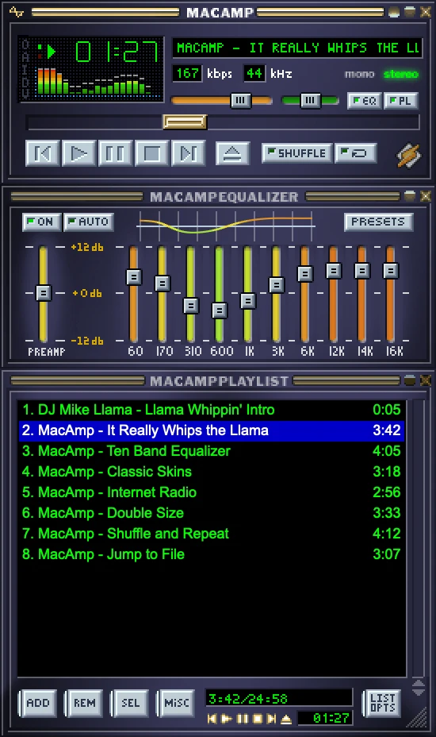

# MacAmp

> Winamp 2.95 for the Mac: the classic skinned player, pixel for pixel, in Swift with AppKit and SwiftUI.

MacAmp is the simple, familiar Winamp on macOS. It starts fast, plays your music and stays out of the way:
the same windows, skins, menus, Preferences, dialogs and hotkeys as Winamp 2.95, and almost no CPU while idle
(paused ≈ 0.01%, playing with the visualizer ≈ 2–3% on an M1). Modern things live under the hood.

**Download:** [latest release](https://github.com/alexrel/macamp/releases/latest) (DMG, Apple Silicon and Intel,
macOS 14 Sonoma or later).

<p align="center"></p>

## Features

- **Main window, Equalizer and Playlist Editor** with magnetic docking, shade modes and Double Size (2x);
  interface scale of 100%, 150% or 200% for large and high-resolution displays.
- **Classic skins:** any Winamp 2.x `.wsz` or skin folder, read on the fly; the base 2.91 skin is built in.
  Cyrillic titles in the skin's own font colors.
- **Playback:** MP3, AAC/M4A, FLAC, WAV/AIFF, Ogg Vorbis/Opus, MP2, AU, MIDI; crossfade and fades,
  follows the system output device.
- **10-band equalizer** with preamp, presets and auto-load by genre; DSP effects (pitch/tempo, reverb).
- **Playlists:** M3U/M3U8, PLS, XSPF and CUE sheets, authentic shuffle/repeat, sort, Jump to File/Time, bookmarks.
- **Internet radio:** SHOUTcast and Icecast streams with live titles.
- **Audio CD:** play and rip to FLAC, ALAC, AAC, WAV or AIFF, with M3U/PLS playlists of the rip.
- **Media Library** with local media, playlists and Internet Radio; **Minibrowser** and **Video** window.
- **Visualizer:** spectrum and oscilloscope in the main window, full-screen Visualizer Studio, MilkDrop through projectM, and What A Goom! 1.99.4.
- **Track Info** with ID3 tag editing, Winamp-style Preferences, About, context menus and the 2.95 hotkeys
  (on any keyboard layout), global hotkeys and media keys.
- **Plug-ins:** the optional FFmpeg plug-in plays MKV/WebM/AVI/WMV and WMA/APE/WavPack (see the release assets).

## What's new since 0.8

- **Interface scale:** Preferences ▸ Display ▸ Interface scale makes every window and dialog 100%, 150% or 200%;
  Double Size still works on top of it.
- **Big folders:** a dropped or added folder shows up in the playlist one directory at a time, the way Winamp
  did it, and track lengths fill in afterwards. A music share with thousands of files no longer looks frozen.
  Clearing the playlist stops a folder that is still loading.
- **Playlist:** smooth trackpad scrolling, and the list only redraws the part that changed.
- **Llama:** the first launch plays the Winamp intro, then leaves it in the playlist as an ordinary entry.
- **Big folders, continued:** rows on screen get their lengths first, wherever the list is scrolled.
- **Menu bar menu:** a long track title scrolls while the menu is open, as it does in the main window; the Dock
  menu cuts it to the same width.
- **Tag editor:** a long file path no longer stretches the window; a genre picked from the list replaces what
  was typed; the genre list button sits inside its field.
- **Dialogs:** a button that opens another dialog no longer stays pressed.
- **New versions:** MacAmp checks GitHub once a day at startup and offers to download a newer release
  (Preferences ▸ Setup; "Check now" asks at once). It opens the disk image and never replaces itself.
- **Fixed:** the playlist keeps its height after leaving shade mode; title bar buttons follow the window's
  focus; window title bars stay reachable when the windows don't fit the screen.

## Roadmap

Planned, in no fixed order:

- MOD / XM / S3M / IT playback.
- MP3 and Ogg Vorbis encoders for CD ripping.
- Last.fm scrobbling, off by default.
- Subsonic servers (Navidrome and others) as a Media Library source.

Not planned: Winamp 3/5 "Modern" skins and a Linux or Windows version.

## Installation

MacAmp is not signed with an Apple Developer ID, so macOS can't verify it on first launch.

1. Open the DMG and drag **MacAmp** to **Applications**. Don't run it from Downloads: macOS starts
   downloaded apps from a read-only location, and the document icon chooser (Preferences ▸ Setup ▸
   File types) can't change icons from there.
2. Launch MacAmp. When macOS says it can't verify the developer, open **System Settings ▸ Privacy &
   Security** and click **Open Anyway**.

   Or remove the quarantine flag in Terminal:

   ```bash
   xattr -dr com.apple.quarantine /Applications/MacAmp.app
   ```

Why the document icon chooser works: Finder takes document icons from the app bundle, so MacAmp swaps
the icon inside `MacAmp.app` and re-signs itself with a local (ad-hoc) signature. That is only possible
because the app isn't signed with a Developer ID, which a local re-sign would replace.

## Visualization

MacAmp ships with GOOM and its effects, plus the projectM engine for MilkDrop. The app bundle includes
both libraries' licenses and matching source archives.

Download MilkDrop presets separately. In **Preferences ▸ Plug-ins ▸ Visualization**, choose
**Open presets folder** and extract the pack there. The folder is
`~/Library/Application Support/MacAmp/Milkdrop`. Use [Cream of the Crop](https://github.com/projectM-visualizer/presets-cream-of-the-crop)
or the [original MilkDrop pack](https://github.com/projectM-visualizer/presets-milkdrop-original)
with its [texture pack](https://github.com/projectM-visualizer/presets-milkdrop-texture-pack).

Press **Tab** to switch Studio modes. In MilkDrop and GOOM, **L** opens the list, and the highlighted
preset or effect applies immediately. Close the list with **L**, **Return** or **Esc**.

## Building

Requires Xcode 16 and CMake 3.21 or later. The first build downloads and builds the pinned projectM release for MilkDrop.

```bash
./build.sh            # Debug build
./build.sh run        # build and run the player
./build.sh dmg        # Release build (Apple Silicon + Intel) packed into build/MacAmp-<version>.dmg
./build.sh test       # run the test suite
scripts/build_ffmpeg_plugin.sh   # the optional FFmpeg plug-in
```

## Credits

Winamp is a trademark of its owners; MacAmp is an independent fan project and is not affiliated with them.
Skin and behavior details were checked against [Webamp](https://github.com/captbaritone/webamp).

## License

MIT
