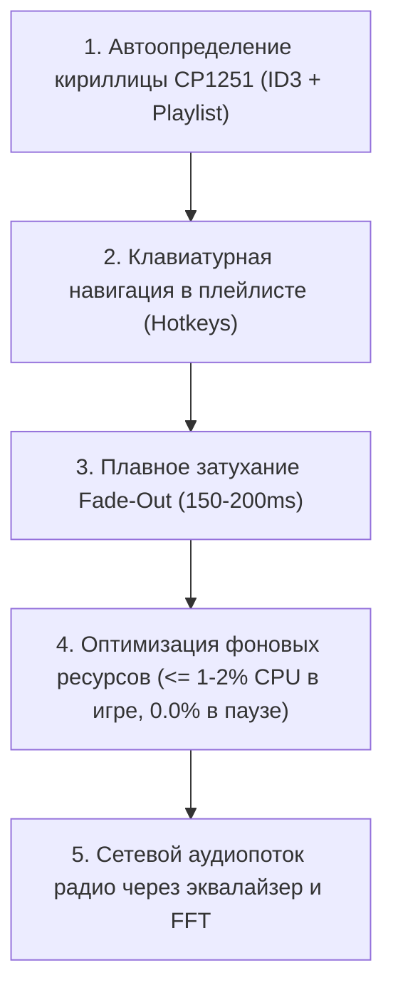

# Техническое задание: Критические улучшения и оптимизация ресурсов MacAmp 2.91

> **Цель проекта:** Аутентичный, пиксель-в-пиксель плеер Winamp 2.91 для macOS, сочетающий ретро-дух с бескомпромиссной производительностью, простотой, продуманностью и минимальным потреблением ресурсов компьютера и батареи.

---

## 1. Оптимизация ресурсов и процессора (CPU & Battery Efficiency)

### 1.1. Главные требования
* **В момент проигрывания (Active Playback):**
  * Потребление процессора не должно превышать **1–2% CPU** на современных процессорах Apple Silicon (M1/M2/M3/M4) и Intel.
  * Плеер выполняет базовые операции: декодирование звука, обновление времени (1 раз в секунду или 10 раз в секунду для миллисекунд), бегущая строка (шаг в 150 мс) и спектроанализатор (19 столбиков). Никаких тяжелых вычислений здесь нет.
  * Исключить постоянные аллокации памяти (zero heap churn): буферы спектра (19 float), массивы точек осциллографа (76 float) и пики должны переиспользоваться без пересоздания массивов каждый кадр.
  * Ограничить частоту `onSpectralDataUpdate` до 30–60 FPS с отсечением холостых тактов, если амплитуды не изменились.
  * В бегущей строке (`MarqueeView`): кэшировать ширину текста в пикселях при установке трека, а не вычислять размер шрифта через `NSString.size(withAttributes:)` на каждом тике таймера.
  * Если текст трека полностью помещается в границы экрана без обрезки — таймер скролла бегущей строки **не должен запускаться вовсе**.
* **В момент паузы и остановки (Paused / Stopped):**
  * Потребление процессора должно падать до **абсолютного нуля (0.0% CPU)**.
  * Все таймеры (`playbackTimer`, `streamTimer`, `scrollTimer`, `temporaryTimer`) полностью инвалидируются или засыпают.
  * Мигание индикатора паузы в окне времени (`TimeDisplayView`) должно использовать один легковесный таймер на 500 мс и обновлять исключительно область цифр времени (`setNeedsDisplay(digitRect)`), а не всё окно `MainWindowView`.
* **При скрытии и минимизации окон (Window Visibility & Occlusion):**
  * Если окна скрыты (`Cmd+H`) или минимизированы в Dock, рендеринг визуализатора и перерисовка бегущей строки полностью приостанавливаются до возвращения окон на экран.

---

## 2. Автоопределение кириллицы в ID3-тегах (Windows-1251 vs Latin-1)

### 2.1. Контекст проблемы
В огромной части фонотек MP3 (особенно эпохи 1998–2010 годов) теги ID3v1 и ID3v2.3 сохранялись в кодировке **Windows-1251 (CP1251)** без маркеров Unicode (BOM). Стандартный парсер macOS `AVFoundation` трактует байты с кодами `0xC0...0xFF` как ISO-8859-1 (Latin-1), что приводит к искажению русских названий в нечитаемые символы:
* `"Кино - Группа крови"` ➔ `"Êèíî - Ãðóïïà êðîâè"`
* `"Алиса - Трасса Е-95"` ➔ `"Àëèñà - Òðàññà Å-95"`
* `"ДДТ - Что такое осень"` ➔ `"ÄÄÒ - ×òî òàêîå îñåíü"`

### 2.2. Требования к реализации
1. Встроить эвристический декодер в `PlaylistModel.resolveArtistAndTitle` и `AudioEngine`:
   * Проверять, содержит ли полученная строка символы диапазона Latin-1 Supplement (`\u{00C0}...\u{00FF}`).
   * Конвертировать строку обратно в сырые байты через `.isoLatin1` и пробовать раскодировать через `CFStringEncodings.windowsCyrillic` (`CP1251`).
   * Если восстановленная строка содержит валидные русские буквы (`\u{0400}...\u{04FF}`) в осмысленном соотношении — принимать раскодированный вариант.
2. Поддержать такое автоопределение для:
   * Названий файлов и папок при Drag-and-Drop.
   * Парсинга строк в `.m3u` и `.pls` плейлистах.
   * Чтения тегов в окне информации ID3 (`TrackInfoWindow`).

---

## 3. Клавиатурная навигация в окне плейлиста (Playlist Hotkeys)

### 3.1. Контекст проблемы
В классическом Winamp окно Playlist Editor было полностью оптимизировано под клавиатуру. Пользователь мог мгновенно управлять списком треков, не касаясь мыши.

### 3.2. Требования к реализации в `PlaylistWindowView.swift`
* Включить поддержку первого респондера (`acceptsFirstResponder = true`).
* Реализовать `keyDown(with event: NSEvent)`:
  * **`Delete` / `Backspace`**: Удаление выделенных треков из плейлиста.
  * **`Enter` / `Return`**: Воспроизведение выбранного трека.
  * **Стрелки `↑` и `↓`**: Перемещение выделения по трекам вверх/вниз с автоматическим скроллом видимой области.
  * **`Shift + ↑ / ↓`**: Расширение диапазона выделения треков.
  * **`Cmd + A` / `Ctrl + A`**: Выделить все треки в плейлисте.
  * **`Space`**: Переключение Play / Pause.
  * **`Alt + 3` / `Option + 3`**: Открытие окна информации и ID3-редактора (`TrackInfoWindow`) для выбранного трека.
  * **`J` / `Ctrl + J`**: Открытие окна быстрого поиска трека (*Jump to File*).
  * **`Home` / `End`**: Переход к первому / последнему треку плейлиста.

---

## 4. Плавное затухание (Audio Fade-Out) при Pause, Stop и смене треков

### 4.1. Контекст проблемы
В окне настроек MacAmp уже присутствует настройка *«Fade out on Pause/Stop: 200 ms»*, но в коде `AudioEngine.swift` воспроизведение останавливалось жестко (`playerNode.stop()` / `playerNode.pause()`), что порождало неприятные щелчки на аудиовыходах.

### 4.2. Требования к реализации
1. При вызове `pause()` или `stop()` во время воспроизведения:
   * Проверить параметр `audioFadeOutDurationMs` из `PersistenceManager.shared.state`.
   * Если длительность > 0 (по умолчанию 200 мс), плавно уменьшать громкость микшера до нуля по кривой затухания.
   * По завершении затухания остановить/приостановить ноду и вернуть громкость в исходное значение.
2. При вызове `play()`:
   * Быстрый микро-fade-in (20–40 мс) для исключения щелчка на первом сэмпле.

---

## 5. Эквалайзер и спектроанализатор для Интернет-радио (SHOUTcast/Icecast)

### 5.1. Требования к реализации
1. Пробросить сетевой декодированный аудиопоток радиостанций в аудиограф `AVAudioEngine` (через `AVAudioSourceNode` или `AVAudioUnitEQ`).
2. Обеспечить, чтобы:
   * 10-полосный эквалайзер и преамп влияли на звучание интернет-радио.
   * DSP-эффекты (темп, тональность, реверберация) могли применяться к потокам.
   * Спектроанализатор и осциллограф отображали реальный аудиопоток с выхода микшера.
3. Встроить авто-переподключение (Auto-Reconnect) при сбоях сетевого соединения (до 3 попыток с задержкой 2 сек).

---

## 6. План и порядок внедрения

